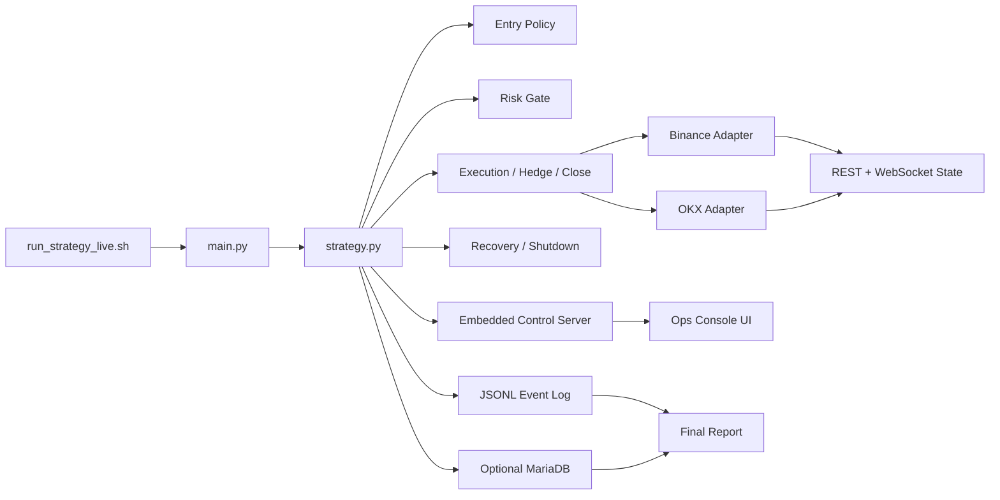

# Funding Arbitrage Execution Engine

Binance Futures와 OKX Futures를 대상으로 한 선물 페어 트레이딩 실행 엔진입니다. 거래소 REST/WebSocket 상태 수집부터 주문, 헷지, 잔여 포지션 복구, 청산과 종료 후 점검까지 다룹니다.

이 프로젝트는 수익률을 홍보하기 위한 저장소가 아닙니다. 현재 초점은 **전략을 교체해도 안전하게 굴러가는 execution / OMS / ops layer**입니다.

## Current Status

- Main path: Binance Futures / OKX Futures
- Runtime: live and test separated by env file
- Control plane: strategy-attached embedded Ops Console
- Persistence: optional MariaDB, DB-less runtime supported
- Public validation: 41 unit/regression tests run by [CI](https://github.com/rhwhdgks/funding-arb-engine/actions)
- Recorded operation: this README includes a 24h live-run `PASS` summary; its raw logs and final report are not in the public repository
- Strategy profitability: evaluated separately from system stability

## What It Handles

- Exchange REST/WebSocket adapters for orderbook, account, position, order, trade, and funding state
- Maker first-leg entry with immediate hedge on the opposite exchange
- Pair close, emergency flatten, account imbalance recovery, and shutdown cleanup
- Entry gates for active pair, open order, margin mode, exposure cap, rate-limit pressure, and manual ownership
- Embedded Ops Console for manual order, hedge, flatten, cancel, pause, and resume
- Structured JSONL events, optional MariaDB persistence, and final PASS/FAIL reports
- Symbol price/funding collector as a separate runtime service

## Design Checks

The operational layer is designed around these checks and recovery paths:

| Area | Guard or check |
| --- | --- |
| Hedge completion | First-leg fills enter hedge or rollback handling; unresolved residuals enter recovery |
| Order safety | Checks cover duplicate orders, overfill, stale orderbook, orphan positions, and open-order mismatches |
| Shutdown | Stop path cancels open orders, closes tracked pairs, checks leftovers, and records shutdown state |
| Control isolation | Console actions go through a command queue using the strategy-owned exchange sessions |
| Auditability | Final report checks events, DB consistency, exchange positions and orders, API pressure, and collector freshness |

## Architecture



## Main Components

| Area | Files |
| --- | --- |
| Runtime entry | [main.py](main.py), [strategy.py](strategy.py) |
| Strategy modules | [src/strategy](src/strategy) |
| Binance adapter | [src/binance_f_module](src/binance_f_module) |
| OKX adapter | [src/okx_f_module](src/okx_f_module) |
| Ops console | [src/ops_console](src/ops_console) |
| Persistence/reporting | [src/ops](src/ops), [scripts/ops](scripts/ops) |
| Runtime scripts | [scripts/runtime](scripts/runtime) |
| DB schema | [sql/trading_dev_schema.sql](sql/trading_dev_schema.sql) |

## Quick Start

Python 3.12 기준입니다. MariaDB persistence를 사용하지 않아도 엔진과 리포트의 핵심 경로는 실행할 수 있습니다.

Ubuntu에서 MariaDB Python driver 빌드가 필요하면 먼저 `libmariadb-dev`를 설치합니다.

```bash
sudo apt-get install libmariadb-dev
git clone https://github.com/rhwhdgks/funding-arb-engine.git
cd funding-arb-engine
python3 -m venv .venv
.venv/bin/python -m pip install --upgrade pip
.venv/bin/python -m pip install -r requirements.lock
```

로컬 설정 파일을 만든 뒤 필요한 값만 채웁니다. 실제 key, token, DB password는 커밋하지 않습니다.

```bash
cp .env.example .env
cp test_server/.env.example test_server/.env
```

기본 검증:

```bash
.venv/bin/python -m compileall -q main.py strategy.py src scripts tests
.venv/bin/python -m unittest discover -s tests -v
bash -n scripts/runtime/run_strategy_live.sh
```

### Test Server

테스트 거래소 credential을 `test_server/.env`에 설정한 뒤 짧은 smoke run부터 시작합니다.

```bash
STRATEGY_ENV_FILE=test_server/.env STRATEGY_RUN_DURATION=30m scripts/runtime/run_strategy_live.sh start
STRATEGY_ENV_FILE=test_server/.env scripts/runtime/run_strategy_live.sh status
STRATEGY_ENV_FILE=test_server/.env scripts/runtime/run_strategy_live.sh stop
```

### Live Trading

실거래는 test-server 검증, shutdown flat 확인, final report 검토 후에만 활성화합니다.

```bash
STRATEGY_ENV_FILE=.env STRATEGY_RUN_DURATION=12h scripts/runtime/run_strategy_live.sh start
```

상태 확인과 종료:

```bash
STRATEGY_ENV_FILE=.env scripts/runtime/run_strategy_live.sh status
STRATEGY_ENV_FILE=.env scripts/runtime/run_strategy_live.sh health
STRATEGY_ENV_FILE=.env scripts/runtime/run_strategy_live.sh stop
```

최종 리포트:

```bash
STRATEGY_ENV_FILE=.env scripts/runtime/run_strategy_live.sh final-report --label real_12h
```

전체 운영 절차와 장애 대응은 [runbook](docs/runbook.md)을 따릅니다.

## Ops Console

Ops Console은 전략 프로세스에 내장된 control plane입니다. 전략이 켜질 때 같이 뜨며, 콘솔이 별도 exchange polling session을 만들지 않으므로 브라우저를 열어도 전략과 별개의 API pressure가 생기지 않습니다.

```env
OPS_CONSOLE_HOST=127.0.0.1
OPS_CONSOLE_PORT=8010
```

```bash
STRATEGY_ENV_FILE=.env scripts/runtime/run_strategy_live.sh start
STRATEGY_ENV_FILE=.env scripts/runtime/run_ops_console.sh status
STRATEGY_ENV_FILE=.env scripts/runtime/run_ops_console.sh health
```

접속:

```text
http://127.0.0.1:8010
```

전략이 꺼져 있으면 콘솔도 사용할 수 없습니다. `run_ops_console.sh start/status/health`는 전략 내장 콘솔이 살아 있는지만 확인하며, standalone backend는 시작하지 않습니다.

## Reports

Final report는 운영 안정성을 판단하는 기준입니다. 전략 수익성 판단과 분리해서 봅니다.

PASS 기준:

- `pair_entry_overfill_detected=0`
- `pair_close_leg_failed=0`
- `pair_close_pending=0`
- `danger_log_lines=0`
- `remaining_positions=[]`
- live Binance/OKX positions `0`
- live Binance/OKX open orders `0`
- DB open-like orders `0`
- order/trade reconcile `PASS`
- API pressure and IP ban checks `PASS`

README에 기록된 24시간 운영 실행의 요약입니다. 해당 실행의 원시 로그와 최종 리포트는 공개 저장소에 포함되지 않으며, `PASS`는 아래 운영 점검에 대한 판정입니다.

```text
final_verdict=PASS warnings=0 failures=0 blocking=0
observed_duration=24h 0m 3s
```

## Documentation

- [docs/README.md](docs/README.md): 목적별 문서 인덱스
- [docs/runbook.md](docs/runbook.md): 실행, 중지, health, final report, 장애 대응
- [docs/env_vars.md](docs/env_vars.md): 환경변수와 secret 분리 원칙
- [docs/security_release.md](docs/security_release.md): secret 교체, console 보안, 재현 가능한 배포 압축 절차
- [docs/operator_log_guide.md](docs/operator_log_guide.md): 운영 로그 해석 기준
- [docs/strategy_experiment_loop.md](docs/strategy_experiment_loop.md): 전략만 교체해 실험하는 표준 루프
- [docs/strategy_evaluation_criteria.md](docs/strategy_evaluation_criteria.md): expected/actual edge와 체결 품질 평가 기준
- [docs/strategy_live_operations_runbook.md](docs/strategy_live_operations_runbook.md): 새 전략을 실거래로 옮기는 운영 절차
- [test_server/README.md](test_server/README.md): 테스트 서버 실행 가이드

## Safety Notes

- This repository is not investment advice.
- Do not commit `.env`, API keys, tokens, DB passwords, runtime files, or logs.
- Live trading should be preceded by test-server runs, shutdown checks, and final report review.
- Strategy profitability is not assumed from operational PASS reports.
- Before publishing or packaging a fork, run `python scripts/release/audit_repository.py --history`.
