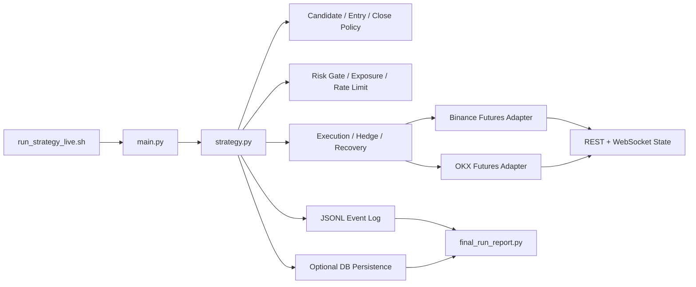

# Funding Fee Arbitrage Runtime

Binance Futures와 OKX Futures의 funding/가격 괴리를 관찰하고, 페어 진입, 헷지, 청산, 기록, 종료 검증까지 한 흐름으로 다루는 선물 차익거래 런타임입니다.

이 저장소의 초점은 수익 보장이 아니라 **실시간 거래 시스템의 실행 안정성**입니다. 한쪽 leg만 남는 상황, overfill, close pending, stale state, DB/거래소 상태 불일치를 줄이고, run 종료 후 리포트로 운영 상태를 확인하는 구조를 정리했습니다.

## 핵심 요약

- 메인 운영 경로는 Binance Futures / OKX Futures pair trading입니다.
- 전략 진입점은 [main.py](main.py), 실제 루프와 상태 관리는 [strategy.py](strategy.py)에 있습니다.
- 거래소 모듈은 `api.py`, `websocket_manager.py`, `exchange.py` 구조를 유지합니다.
- 신규 진입 전 RiskGate가 active pair, open order, margin mode, exposure cap, manual pause, manual ownership lock, rate-limit pressure를 확인합니다.
- Ops Console 수동 주문은 `manual_only` ownership으로 기록해 strategy recovery/shutdown이 임의로 건드리지 않게 할 수 있습니다.
- close, recovery, shutdown flatten은 신규 진입 gate와 분리해 포지션 중립성을 우선합니다.
- structured JSONL 로그, 선택적 MariaDB persistence, final PASS/FAIL report로 운영 결과를 확인합니다.

## Architecture



## 빠른 실행

아래 명령은 프로젝트 루트에서 실행한다고 가정합니다. 실제 운영 절차와 장애 대응은 [docs/runbook.md](docs/runbook.md)를 기준으로 확인합니다.

실행 전 확인:

```bash
.venv/bin/python -m py_compile main.py strategy.py src/strategy/config.py src/strategy/candidates.py src/strategy/close_policy.py src/strategy/execution.py
bash -n scripts/runtime/run_strategy_live.sh
```

실서버 12시간 실행:

```bash
STRATEGY_ENV_FILE=.env STRATEGY_RUN_DURATION=12h scripts/runtime/run_strategy_live.sh start
```

테스트 서버 30분 실행:

```bash
STRATEGY_ENV_FILE=test_server/.env STRATEGY_RUN_DURATION=30m scripts/runtime/run_strategy_live.sh start
```

상태/요약/중지:

```bash
STRATEGY_ENV_FILE=.env scripts/runtime/run_strategy_live.sh status
STRATEGY_ENV_FILE=.env scripts/runtime/run_strategy_live.sh summary
STRATEGY_ENV_FILE=.env scripts/runtime/run_strategy_live.sh stop
```

종료 후 최종 리포트:

```bash
STRATEGY_ENV_FILE=.env scripts/runtime/run_strategy_live.sh final-report --label real_12h
```

## 운영 관점

운영 중 신규 진입만 멈출 수 있습니다. 이 상태에서도 기존 pair close, recovery, shutdown cleanup은 계속 허용되어야 합니다.

```bash
STRATEGY_ENV_FILE=.env scripts/runtime/entry_pause.sh on manual_pause
STRATEGY_ENV_FILE=.env scripts/runtime/entry_pause.sh off manual_resume
STRATEGY_ENV_FILE=.env scripts/runtime/entry_pause.sh status
```

수동 확인/주문은 Ops Console로 봅니다. 기본 권장값은 로컬 전용 바인딩입니다.

```bash
STRATEGY_ENV_FILE=.env scripts/runtime/run_ops_console.sh start
STRATEGY_ENV_FILE=.env scripts/runtime/run_ops_console.sh health
```

`OPS_CONSOLE_HOST=127.0.0.1`이면 같은 PC의 `http://127.0.0.1:8010`에서만 접속됩니다. 폰이나 다른 장비에서 접속할 목적이면 VPN/터널과 action token을 같이 사용합니다.

final report에서 우선 확인하는 신호는 overfill, close failure, close pending, danger log, DB open-like order, live position/open order 잔존 여부입니다. 체결이 없는 run도 시장 조건상 정상일 수 있으므로, 수익성 평가와 운영 안정성 평가는 분리해서 봅니다.

## 저장소 구조

```text
.
├── main.py                         # 전략 실행 진입점
├── strategy.py                     # pair 관리, entry/close/recovery/shutdown runtime
├── src/
│   ├── binance_f_module/           # Binance Futures REST/WS/exchange adapter
│   ├── okx_f_module/               # OKX Futures REST/WS/exchange adapter
│   ├── gateio_f_module/            # Gate.io Futures adapter
│   ├── hyperliquid_f_module/       # Hyperliquid Futures adapter
│   ├── strategy/                   # candidate, policy, hedge, risk gate, execution
│   └── ops/                        # persistence, reports, ops web support
├── scripts/
│   ├── runtime/                    # strategy launcher, collectors, pause control
│   ├── ops/                        # reports and reconcile helpers
│   └── db/                         # DB schema initialization
├── sql/                            # MariaDB schema
├── test_server/                    # test server entrypoint and guide
├── reference/                      # requirements and comparison references
└── docs/                           # runbook, env, repo map, status, presentation notes
```

## 문서 안내

- [docs/runbook.md](docs/runbook.md): 실행, 중지, 리포트, 장애 대응 기준
- [docs/repo_map.md](docs/repo_map.md): 파일 구조와 추천 읽기 순서
- [docs/current_status.md](docs/current_status.md): 현재 상태와 다음 우선순위
- [docs/strategy_quality_roadmap.md](docs/strategy_quality_roadmap.md): 전략 품질 100점 목표와 우선순위
- [docs/question4_comparison.md](docs/question4_comparison.md): question4 대비 속도, 안정성, 구현 방식 비교
- [docs/env_vars.md](docs/env_vars.md): 환경변수 역할과 분리 원칙
- [docs/development_requirements_checklist.md](docs/development_requirements_checklist.md): [reference/개발요구사항.txt](reference/개발요구사항.txt) 대비 반영 상태
- [docs/presentation_summary.md](docs/presentation_summary.md): 발표용 개발 요약
- [test_server/README.md](test_server/README.md): 테스트 서버 실행법과 주의사항

## 주의

- 이 저장소는 투자 권유나 자동매매 사용 권장이 아닙니다.
- 공개 저장소에는 `.env`, 거래소 인증 정보, DB 접속 정보, 실계좌 식별 정보를 포함하지 않습니다.
- live 실행 전에는 테스트 서버와 제한된 설정에서 shutdown, recovery, final report까지 확인하는 것을 전제로 합니다.
