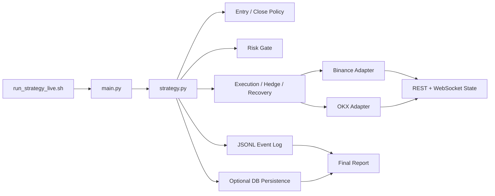

# Funding Arbitrage Execution Engine

Binance Futures와 OKX Futures를 대상으로 한 선물 차익거래 실행 엔진입니다.
핵심 목표는 단순한 전략 아이디어 구현이 아니라, 실시간 거래 환경에서 **페어 진입, 헷지, 청산, 복구, 운영 검증**이 일관되게 동작하는 시스템을 만드는 것입니다.

## What This Project Does

- 거래소별 REST/WebSocket adapter로 orderbook, account, position, order 상태를 수집합니다.
- 가격 괴리와 funding 조건을 기반으로 long/short pair 후보를 만들고 진입 여부를 판단합니다.
- 첫 leg 체결 이후 반대 거래소에 hedge를 넣어 net exposure를 중립에 가깝게 맞춥니다.
- close, recovery, shutdown 경로를 신규 진입 로직과 분리해 한쪽 포지션만 남는 상황을 줄입니다.
- structured JSONL 로그, optional MariaDB persistence, final PASS/FAIL report로 run 결과를 검증합니다.
- Ops Console을 통해 수동 주문, 자동 hedge, 포지션 정리, entry pause를 운영할 수 있습니다.

## Engineering Focus

이 저장소는 수익률을 홍보하기 위한 프로젝트가 아닙니다. 초점은 자동매매 시스템에서 실제로 문제가 되는 실행 안정성입니다.

- **Hedge completeness**: 한쪽 leg만 남았을 때 recovery/neutralize 경로로 중립성 복구
- **Order safety**: overfill, duplicate order, stale orderbook, open order mismatch 방지
- **Risk gate**: active pair, open order, margin mode, exposure cap, rate-limit pressure, manual ownership lock 확인
- **Operational control**: entry pause/resume, safe stop, shutdown flatten, live health check
- **Auditability**: order/trade/balance/funding/entry quality 기록과 after-run report

## Architecture



## Main Components

| Area | Files |
| --- | --- |
| Runtime entry | [main.py](main.py), [strategy.py](strategy.py) |
| Strategy modules | [src/strategy](src/strategy) |
| Binance adapter | [src/binance_f_module](src/binance_f_module) |
| OKX adapter | [src/okx_f_module](src/okx_f_module) |
| Ops console | [src/ops_console](src/ops_console) |
| Persistence/reporting | [src/ops](src/ops), [scripts/ops](scripts/ops) |
| Runtime scripts | [scripts/runtime](scripts/runtime) |
| DB schema | [sql/trading_dev_schema.sql](sql/trading_dev_schema.sql) |

## Quick Start

실행값은 `.env` 또는 `test_server/.env`에 둡니다. 실제 key, token, DB password는 커밋하지 않습니다.

```bash
.venv/bin/python -m py_compile main.py strategy.py src/strategy/config.py
bash -n scripts/runtime/run_strategy_live.sh
```

테스트 서버 실행:

```bash
STRATEGY_ENV_FILE=test_server/.env STRATEGY_RUN_DURATION=30m scripts/runtime/run_strategy_live.sh start
```

실서버 실행:

```bash
STRATEGY_ENV_FILE=.env STRATEGY_RUN_DURATION=12h scripts/runtime/run_strategy_live.sh start
```

상태 확인과 종료:

```bash
STRATEGY_ENV_FILE=.env scripts/runtime/run_strategy_live.sh status
STRATEGY_ENV_FILE=.env scripts/runtime/run_strategy_live.sh health
STRATEGY_ENV_FILE=.env scripts/runtime/run_strategy_live.sh stop
```

최종 리포트:

```bash
STRATEGY_ENV_FILE=.env scripts/runtime/run_strategy_live.sh final-report --label real_12h
```

## Ops Console

Ops Console은 수동 주문과 운영 제어를 위한 로컬 콘솔입니다. 기본 권장값은 로컬 전용입니다.

```env
OPS_CONSOLE_HOST=127.0.0.1
OPS_CONSOLE_PORT=8010
```

```bash
STRATEGY_ENV_FILE=.env scripts/runtime/run_ops_console.sh start
```

접속:

```text
http://127.0.0.1:8010
```

원격 접속이 필요하면 포트포워딩으로 직접 노출하지 않고 VPN/터널과 action token을 같이 사용합니다.

## Documentation

- [docs/runbook.md](docs/runbook.md): 실행, 중지, health, final report, 장애 대응
- [docs/env_vars.md](docs/env_vars.md): 환경변수와 secret 분리 원칙
- [docs/operator_log_guide.md](docs/operator_log_guide.md): 운영 로그 해석 기준
- [docs/development_requirements_checklist.md](docs/development_requirements_checklist.md): 요구사항 반영 상태
- [docs/question4_comparison.md](docs/question4_comparison.md): reference 구현과의 비교
- [docs/strategy_quality_roadmap.md](docs/strategy_quality_roadmap.md): 전략 품질 개선 로드맵
- [test_server/README.md](test_server/README.md): 테스트 서버 실행 가이드

## Status

- Main exchange path: Binance Futures / OKX Futures
- Runtime mode: live/test separated by env file
- Persistence: optional MariaDB, DB-less runtime supported
- Operations: safe stop, entry pause, final report, ops console available
- Current priority: improve strategy quality while keeping execution and recovery paths stable

## Safety Notes

- This repository is not investment advice.
- Do not commit `.env`, API keys, tokens, DB passwords, runtime files, or logs.
- Live trading should be preceded by test-server runs, shutdown checks, and final report review.
