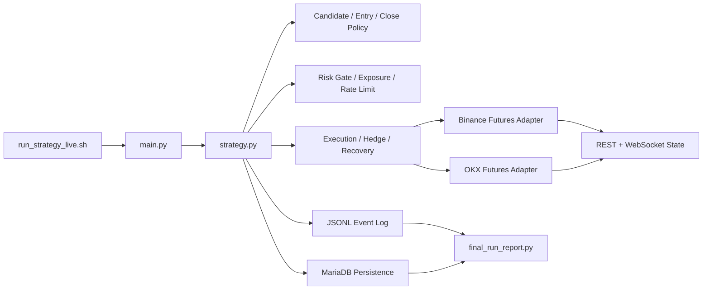

# Funding Fee Arbitrage Runtime

Binance Futures와 OKX Futures 사이의 funding/가격 괴리를 관찰하고, 페어 진입, 헷지, 청산, DB 기록, 운영 리포트까지 한 흐름으로 다루는 선물 차익거래 런타임입니다.

이 프로젝트의 초점은 전략 성과 홍보가 아니라 **실시간 거래 시스템의 실행 안정성**입니다. 한쪽 leg만 남는 상황, overfill, close pending, stale state, DB/거래소 상태 불일치를 줄이고, run 종료 후 자동 리포트로 PASS/FAIL을 판단하는 운영 구조를 갖추는 데 집중했습니다.

## Project Overview

- **Market**: Binance Futures / OKX Futures 중심의 perpetual futures pair trading
- **Strategy Loop**: funding rate, orderbook, balance/account state를 바탕으로 후보를 만들고 pair entry/close를 관리
- **Execution**: maker first-leg 진입 후 taker/marketable hedge, close/recovery/shutdown 경로 분리
- **Ops**: structured JSONL event log, MariaDB optional persistence, final PASS/FAIL report
- **Environment**: root `.env`와 `test_server/.env`를 분리해 live/test_server 실행을 같은 코드로 운영

## Core Features

### Real-time Exchange Integration

- 거래소별 `api.py`, `websocket_manager.py`, `exchange.py` 구조로 REST 주문/조회와 WebSocket orderbook/tick state를 분리했습니다.
- 현재 메인 전략 경로는 Binance Futures와 OKX Futures pair를 기준으로 동작합니다.
- Gate.io Futures, Hyperliquid Futures 모듈도 존재하지만 README의 실행 흐름은 Binance/OKX 기준입니다.

### Maker/Taker Entry & Hedge

- 후보별 long/short 거래소를 정하고, 첫 leg를 maker로 놓은 뒤 체결 시 반대 leg를 hedge합니다.
- post-first-fill edge check, hedge requote, market hedge, partial fill progress logging을 통해 first leg 체결 후 남는 위험을 줄입니다.
- 정상 청산은 safe taker 또는 설정에 따른 maker-then-taker 경로를 사용하고, 실패 시 recovery/neutralize 경로로 넘깁니다.

### Risk Gate

- 신규 진입 전에 active symbol, 동일 symbol/side open order, entry pause, margin mode, exposure cap, rate-limit pressure를 확인합니다.
- exposure cap은 계정 equity 대비 gross/long/short notional을 계산해 신규 진입만 차단합니다.
- close, recovery, shutdown flatten은 risk gate나 pause 때문에 막히지 않도록 분리되어 있습니다.

### Persistence & Reports

- `trade_history`를 체결 truth source로 두고, `order_history`, `balance_snapshot`, `funding_rate`, `symbol_price`, `fx`, `cashflow_ledger`를 운영 관찰용으로 적재합니다.
- DB 설정이 없으면 persistence를 비활성화하고 전략 런타임은 계속 실행합니다.
- final report는 after-run summary, DB reconcile, live exchange flat check, symbol price freshness를 묶어 PASS/FAIL을 냅니다.

### Shutdown & Recovery

- `SIGTERM`/stop 요청 시 open order cancel, open pair close, 잔여 포지션 flatten, 최종 remaining position 확인을 수행합니다.
- shutdown 결과는 `shutdown_cleanup_started`, `shutdown_cleanup_done` 이벤트로 남기고 final report에서 검증합니다.

### Test/Live Env Separation

- 실서버는 `.env`, 테스트 서버는 `test_server/.env`를 사용합니다.
- 테스트 서버도 루트의 동일한 전략 코드를 실행하며, 환경 파일과 runtime log 경로만 분리합니다.

## Requirements Coverage

이 프로젝트는 [reference/개발요구사항.txt](reference/개발요구사항.txt)의 요구사항을 운영 체크리스트로 두고 개발했습니다. 상세 반영 상태는 [docs/development_requirements_checklist.md](docs/development_requirements_checklist.md)에 정리되어 있습니다.

| 영역 | 반영 내용 |
| --- | --- |
| 주문/체결 | 지정가 주문, 주문 취소, 전체 취소, 체결 조회, open order reconcile |
| Market Data | orderbook/tick WebSocket, server/PC time drift 점검, symbol price collector |
| 계정/잔고 | 거래소별 balance report, equity/notional 계산, balance snapshot 저장 |
| Funding | 실시간 funding rate 조회와 funding snapshot/report 반영 |
| 초기 세팅 | leverage bootstrap, cross margin 설정/검증, margin mode normalize |
| 호출량 관리 | rate-limit guard, REST circuit breaker, block reason/report 연동 |
| DB | `trade_history`, `order_history`, `balance_snapshot`, `funding_rate`, `symbol_price`, `fx`, `cashflow_ledger` |
| 추상화 | 거래소별 REST/WS/exchange adapter 분리, Binance/OKX 중심 운영, Gate/Hyperliquid 확장 모듈 보유 |

리스크 관리 요구사항은 신규 진입 gate 중심으로 반영했습니다.

- Global order gate: exchange/account/market 상태, open order, active pair, manual pause, margin mode, exposure cap, rate-limit pressure 확인
- Symbol 제한: symbol당 active pair와 exchange/symbol/side open order 중복 방지
- Cross margin: startup/bootstrap에서 cross/crossed 표현을 normalize하고 신규 진입 전 검증
- Exposure cap: gross/long/short leverage를 계산해 신규 진입만 차단
- Safety exception: close, recovery, shutdown flatten은 신규 진입 gate에 막히지 않도록 분리

아직 후순위로 남겨둔 항목도 있습니다. 1분봉 collector, 범용 tick collector 확장, 거래소별/symbol별 exposure cap, normal close fee gate는 현재 핵심 운영 안정성 이후 단계로 분리했습니다.

## Architecture



핵심 진입점은 [main.py](main.py)이고, 실제 전략 루프는 [strategy.py](strategy.py)에 있습니다. 전략 보조 로직은 [src/strategy](src/strategy), 운영 저장/리포트 보조 로직은 [src/ops/persistence](src/ops/persistence)에 나뉘어 있습니다.

## Run

아래 명령은 가상환경과 의존성이 준비된 프로젝트 루트에서 실행한다고 가정합니다.

실행 전 문법/컴파일 확인:

```bash
.venv/bin/python -m py_compile main.py strategy.py src/strategy/config.py src/strategy/candidates.py src/strategy/close_policy.py src/strategy/execution.py
bash -n scripts/runtime/run_strategy_live.sh
```

실서버 12시간 실행:

```bash
STRATEGY_ENV_FILE=.env STRATEGY_RUN_DURATION=12h scripts/runtime/run_strategy_live.sh start
```

테스트 서버 30분 실행:

```bash
STRATEGY_ENV_FILE=test_server/.env STRATEGY_RUN_DURATION=30m scripts/runtime/run_strategy_live.sh start
```

상태/로그/요약:

```bash
STRATEGY_ENV_FILE=.env scripts/runtime/run_strategy_live.sh status
STRATEGY_ENV_FILE=.env scripts/runtime/run_strategy_live.sh logs
STRATEGY_ENV_FILE=.env scripts/runtime/run_strategy_live.sh jsonl
STRATEGY_ENV_FILE=.env scripts/runtime/run_strategy_live.sh summary
```

중지와 최종 리포트:

```bash
STRATEGY_ENV_FILE=.env scripts/runtime/run_strategy_live.sh stop
STRATEGY_ENV_FILE=.env scripts/runtime/run_strategy_live.sh final-report --label real_12h
```

무기한 실행은 `STRATEGY_RUN_DURATION=forever`를 사용하고, final report는 직접 stop한 뒤 생성합니다.

## Operations & Verification

운영 중 신규 진입만 멈출 수 있습니다. 이 상태에서도 기존 pair close, recovery, shutdown cleanup은 계속 허용됩니다.

```bash
STRATEGY_ENV_FILE=.env scripts/runtime/entry_pause.sh on manual_pause
STRATEGY_ENV_FILE=.env scripts/runtime/entry_pause.sh off manual_resume
STRATEGY_ENV_FILE=.env scripts/runtime/entry_pause.sh status
```

보조 수집기:

```bash
STRATEGY_ENV_FILE=.env scripts/runtime/run_symbol_price_collector.sh start
STRATEGY_ENV_FILE=.env scripts/runtime/run_fx_collector.sh start
```

장기 soak 검증은 timed run 또는 forever run 이후 `final-report`로 판단합니다. 운영 PASS 기준은 아래 신호가 모두 깨끗한지 보는 방식입니다.

- `pair_entry_overfill_detected=0`
- `pair_close_leg_failed=0`
- `pair_close_pending=0`
- `danger_log_lines=0`
- shutdown 후 `remaining_positions=[]`
- shutdown 후 `pending_pair_ids=[]`
- Binance/OKX live positions `0`
- Binance/OKX live open orders `0`
- DB open-like orders `0`
- symbol price collector freshness 정상

체결이 없는 run도 정상입니다. 시장 조건이 맞지 않아 pair가 열리지 않은 경우 final report에는 `pair_opened=0`, `pair_closed=0`으로 표시될 수 있습니다.

## DB & Logs

- 기본 로그: `logs/strategy_live.out`
- structured event log: `logs/strategy_live.jsonl`
- run metadata: `logs/strategy_live.run.json`
- DB schema: [sql/trading_dev_schema.sql](sql/trading_dev_schema.sql)
- DB 초기화 스크립트: [scripts/db/init_db_schema.py](scripts/db/init_db_schema.py)

MariaDB 환경변수가 없으면 DB writer는 자동으로 꺼집니다. DB를 사용할 때도 거래소 인증 정보와 접속 정보는 README나 GitHub에 올리지 않고 로컬 `.env`에서만 관리합니다.

## Risk Management

- **Position Neutrality**: pair close, recovery, shutdown flatten을 신규 진입 gate와 분리
- **Exposure Cap**: projected gross/long/short leverage가 설정값을 넘으면 신규 진입 차단
- **Order Safety**: 동일 symbol pair 중복 진입과 동일 symbol/side open order 중복 제출 방지
- **Rate Limit Guard**: 거래소 rate-limit 사용률과 cooldown 상태를 보고 신규 진입 차단
- **Entry Pause**: 운영자가 파일 기반 control로 신규 진입만 일시정지 가능
- **Final Flat Check**: 종료 후 live position/open order와 DB open-like order를 함께 검증

## Current Status

- 메인 운영 경로는 Binance/OKX Futures pair입니다.
- 실서버와 테스트 서버는 같은 코드베이스를 사용하고 환경 파일만 분리합니다.
- 운영 안정성 검증은 final PASS/FAIL report 중심으로 정리되어 있습니다.
- 기록된 검증 결과는 [docs/presentation_summary.md](docs/presentation_summary.md)에 정리되어 있으며, 전략 성과 약속이 아니라 실행 안정성 검증 기록으로 봅니다.
- 자세한 운영 절차는 [docs/runbook.md](docs/runbook.md), 환경변수 설명은 [docs/env_vars.md](docs/env_vars.md)를 기준으로 봅니다.
- 개발요구사항 대비 반영 상태는 [docs/development_requirements_checklist.md](docs/development_requirements_checklist.md)를 기준으로 봅니다.

## Directory Structure

```text
.
├── main.py                         # 전략 실행 진입점
├── strategy.py                     # pair 관리, entry/close/recovery/shutdown runtime
├── src/
│   ├── binance_f_module/           # Binance Futures REST/WS/exchange adapter
│   ├── okx_f_module/               # OKX Futures REST/WS/exchange adapter
│   ├── strategy/                   # candidate, policy, hedge, risk gate, execution
│   └── ops/                        # persistence, reports, ops web support
├── scripts/
│   ├── runtime/                    # live/test launcher, collectors, pause control
│   ├── ops/                        # final report, reconcile, summary tools
│   └── db/                         # DB schema initialization
├── sql/                            # MariaDB schema
├── test_server/                    # test_server env/run guide
└── docs/                           # runbook, env vars, repo map, status notes
```

## Notes

- 이 저장소는 실거래 또는 자동매매 사용을 권장하기 위한 자료가 아닙니다.
- 공개 저장소에는 `.env`, 거래소 인증 정보, DB 접속 정보, 실계좌 식별 정보를 포함하지 않아야 합니다.
- live 실행 전에는 테스트 서버와 소액/제한된 설정에서 shutdown, recovery, final report까지 확인하는 것을 전제로 합니다.
- 자세한 장애 대응과 PASS/FAIL 해석은 [docs/runbook.md](docs/runbook.md)를 기준으로 확인합니다.
