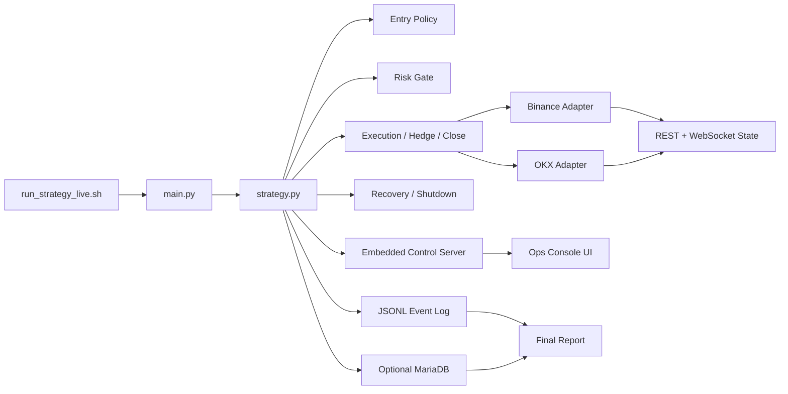

# funding-arb-engine

바이낸스와 OKX 선물시장에서 두 포지션을 한 쌍으로 관리하는 주문 실행 엔진입니다. 한쪽 주문이 먼저 체결되면 다른 거래소에 반대 방향 주문을 내 노출을 줄이고, 실패나 중단 뒤에는 남은 포지션과 주문을 확인해 복구합니다.

이 저장소는 주문 실행과 운영 점검을 다룹니다. 전략의 수익성은 별도로 평가합니다.

## 기능

- REST API·WebSocket으로 호가, 계좌, 포지션, 주문, 체결, 펀딩비 상태 수집
- 첫 거래소 체결 후 반대 거래소 헤지 주문 실행
- 거래 종료, 긴급 청산, 계좌 불균형 복구, 종료 후 잔여 상태 확인
- 진입 전 점검: 중복 주문, 노출 한도, 주문 대기, API 호출 제한
- 운영 콘솔: 수동 주문·취소, 위험 축소, 일시정지·재개
- 사건별 JSONL 기록, MariaDB 저장(선택), 종료 점검 보고서
- 가격·펀딩비 수집기를 별도 서비스로 실행
- 실거래·테스트 설정을 환경 파일로 분리

## 예외 상황 처리

| 상황 | 처리 |
| --- | --- |
| 한쪽 주문만 체결 | 반대쪽 헤지 또는 주문 취소, 남은 수량은 복구 대상으로 관리 |
| 주문 상태 불일치 | 중복 주문, 초과 체결, 오래된 호가, 추적되지 않는 포지션·주문 확인 |
| 프로그램 종료 | 열린 주문 취소, 추적 중인 거래 종료, 남은 포지션 확인 |
| 수동 조작 | 운영 콘솔 명령도 전략과 같은 거래소 연결로 처리 |
| 사후 점검 | 사건 기록, DB·거래소 상태, API 사용량, 수집 데이터 최신성 대조 |

## 구성



| 역할 | 위치 |
| --- | --- |
| 실행 시작점 | [main.py](main.py), [strategy.py](strategy.py) |
| 전략 모듈 | [src/strategy](src/strategy) |
| 거래소 연동 | [src/binance_f_module](src/binance_f_module), [src/okx_f_module](src/okx_f_module) |
| 운영 콘솔 | [src/ops_console](src/ops_console) |
| 기록·보고서 | [src/ops](src/ops), [scripts/ops](scripts/ops) |
| 실행 스크립트 | [scripts/runtime](scripts/runtime) |
| DB 스키마 | [sql/trading_dev_schema.sql](sql/trading_dev_schema.sql) |

## 실행

Python 3.12 기준입니다. MariaDB 없이도 엔진과 보고서를 실행할 수 있습니다. Ubuntu에서 MariaDB 드라이버를 빌드하려면 `libmariadb-dev`가 필요합니다.

```bash
git clone https://github.com/rhwhdgks/funding-arb-engine.git
cd funding-arb-engine
python3 -m venv .venv
.venv/bin/python -m pip install -r requirements.lock

cp .env.example .env
cp test_server/.env.example test_server/.env
```

테스트 (단위·회귀 테스트 41개, [CI](https://github.com/rhwhdgks/funding-arb-engine/actions))

```bash
.venv/bin/python -m unittest discover -s tests -v
```

테스트 서버에서 먼저 짧게 실행한 뒤, 잔여 포지션과 종료 보고서를 확인하고 실거래로 넘어갑니다.

```bash
# 테스트 서버
STRATEGY_ENV_FILE=test_server/.env STRATEGY_RUN_DURATION=30m scripts/runtime/run_strategy_live.sh start
STRATEGY_ENV_FILE=test_server/.env scripts/runtime/run_strategy_live.sh status
STRATEGY_ENV_FILE=test_server/.env scripts/runtime/run_strategy_live.sh stop

# 실거래
STRATEGY_ENV_FILE=.env STRATEGY_RUN_DURATION=12h scripts/runtime/run_strategy_live.sh start
STRATEGY_ENV_FILE=.env scripts/runtime/run_strategy_live.sh health
STRATEGY_ENV_FILE=.env scripts/runtime/run_strategy_live.sh final-report --label real_12h
```

운영 콘솔은 전략 프로세스 안에서 함께 뜨며(기본 `http://127.0.0.1:8010`), 거래소 조회도 전략의 연결을 같이 씁니다. 전체 절차와 장애 대응은 [docs/runbook.md](docs/runbook.md)에 있습니다.

## 종료 점검 보고서

실행이 끝나면 주문·포지션이 정상적으로 정리됐는지 판정합니다. 수익성은 판정 대상이 아닙니다.

PASS 기준

- `pair_entry_overfill_detected=0`, `pair_close_leg_failed=0`, `pair_close_pending=0`, `danger_log_lines=0`
- `remaining_positions=[]`, 거래소 잔여 포지션·미체결 주문 0, DB에 열린 주문 0
- 주문·체결 내역 대조, API 호출량·접속 제한 점검 PASS

24시간 실행 결과 (원시 로그와 보고서 파일은 공개 저장소에 포함하지 않음)

```text
final_verdict=PASS warnings=0 failures=0 blocking=0
observed_duration=24h 0m 3s
```

## 문서

- [docs/runbook.md](docs/runbook.md): 실행, 중지, health, final report, 장애 대응
- [docs/env_vars.md](docs/env_vars.md): 환경변수와 secret 분리
- [docs/security_release.md](docs/security_release.md): secret 교체, 콘솔 보안, 배포 절차
- [docs/operator_log_guide.md](docs/operator_log_guide.md): 운영 로그 해석
- [docs/strategy_experiment_loop.md](docs/strategy_experiment_loop.md): 전략만 교체해 실험하는 절차
- [docs/strategy_evaluation_criteria.md](docs/strategy_evaluation_criteria.md): 기대·실현 edge와 체결 품질 평가 기준
- [docs/strategy_live_operations_runbook.md](docs/strategy_live_operations_runbook.md): 새 전략의 실거래 전환 절차
- [test_server/README.md](test_server/README.md): 테스트 서버 설정

## 주의

- 투자 조언이 아닙니다.
- `.env`, API 키, 토큰, DB 비밀번호, 실행 로그는 커밋하지 않습니다. 공개 전에는 `python scripts/release/audit_repository.py --history`로 점검합니다.
