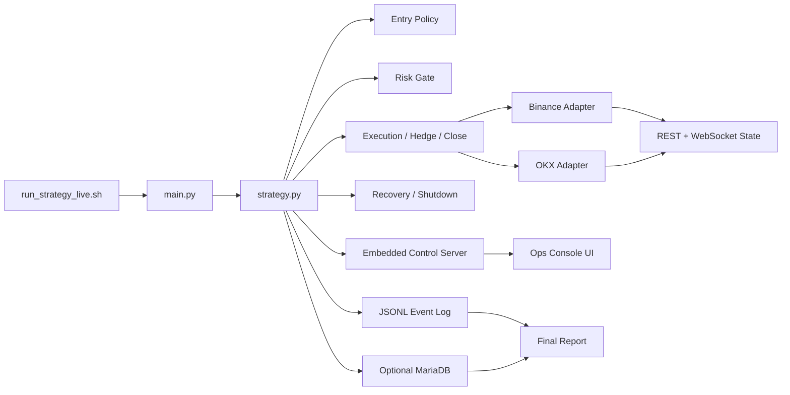

# 선물 거래 실행 엔진

바이낸스와 OKX 선물시장에서 두 포지션을 한 쌍으로 관리하는 프로그램입니다. 한쪽 주문만 먼저 체결되면 다른 거래소에 반대 방향 주문을 내 위험을 줄입니다. 실패하거나 중단될 때는 남은 포지션을 확인·복구합니다.

거래소의 시세·계좌·주문 상태는 REST API와 WebSocket으로 받아옵니다. 이 저장소는 **주문 실행과 운영 점검**을 다루며, 투자 전략의 수익성은 별도로 평가합니다.

## 현재 범위와 검증

- 주요 연동: Binance Futures, OKX Futures
- 실거래와 테스트 설정은 별도 환경 파일로 분리
- 전략 프로세스 안에서 주문·중지 상태를 제어하는 운영 콘솔 제공
- 거래 기록은 MariaDB에 저장할 수 있으며, 데이터베이스 없이도 실행 가능
- 공개 검증: 단위·회귀 테스트 41개와 [자동 테스트 기록](https://github.com/rhwhdgks/funding-arb-engine/actions)
- 운영 기록: README에 24시간 실행의 운영 점검 `PASS` 요약을 기록함. 해당 실행의 원시 로그와 최종 보고서는 공개 저장소에 포함되지 않음
- 전략 수익성은 시스템 운영 안정성과 별도로 평가

## 구현한 기능

- REST API와 WebSocket으로 호가·계좌·포지션·주문·체결·펀딩비 상태 수집
- 첫 거래소의 주문이 체결되면 반대 거래소에서 위험을 줄이는 주문 실행
- 거래 종료, 긴급 포지션 정리, 계좌 불균형 복구, 종료 후 잔여 상태 확인
- 중복 주문·노출 한도·주문 대기·API 호출 제한 등을 확인하는 진입 조건
- 수동 주문·취소·위험 축소·일시정지·재개를 위한 운영 콘솔
- 사건별 JSONL 기록, 선택적 MariaDB 저장, 종료 후 점검 보고서
- 가격·펀딩비 수집기를 별도 서비스로 실행

## 위험 상황 점검

주문이 예상과 다르게 진행될 때 다음 경로를 확인하도록 설계했습니다.

| 상황 | 처리 또는 점검 |
| --- | --- |
| 한쪽 주문만 체결 | 반대쪽 거래나 주문 취소를 시도하고, 남은 수량은 복구 대상으로 관리 |
| 주문 상태 불일치 | 중복 주문, 초과 체결, 오래된 호가, 추적되지 않는 포지션·주문을 확인 |
| 프로그램 종료 | 열린 주문 취소, 추적 중인 거래 종료, 남은 포지션과 종료 상태 확인 |
| 수동 조작 | 운영 콘솔 명령도 전략이 사용하는 거래소 연결을 통해 처리 |
| 사후 점검 | 사건 기록, DB와 거래소 상태, API 사용량, 수집 데이터의 최신성 확인 |

## 시스템 구성



## 주요 코드

| 역할 | 파일 |
| --- | --- |
| 실행 시작점 | [main.py](main.py), [strategy.py](strategy.py) |
| 전략 모듈 | [src/strategy](src/strategy) |
| 바이낸스 연동 | [src/binance_f_module](src/binance_f_module) |
| OKX 연동 | [src/okx_f_module](src/okx_f_module) |
| 운영 콘솔 | [src/ops_console](src/ops_console) |
| 기록·보고서 | [src/ops](src/ops), [scripts/ops](scripts/ops) |
| 실행 스크립트 | [scripts/runtime](scripts/runtime) |
| DB 테이블 정의 | [sql/trading_dev_schema.sql](sql/trading_dev_schema.sql) |

## 실행 방법

Python 3.12 기준입니다. MariaDB에 저장하지 않아도 엔진과 보고서의 핵심 기능을 실행할 수 있습니다.

Ubuntu에서 MariaDB Python driver 빌드가 필요하면 먼저 `libmariadb-dev`를 설치합니다.

```bash
sudo apt-get install libmariadb-dev
git clone https://github.com/rhwhdgks/funding-arb-engine.git
cd funding-arb-engine
python3 -m venv .venv
.venv/bin/python -m pip install --upgrade pip
.venv/bin/python -m pip install -r requirements.lock
```

로컬 설정 파일을 만든 뒤 필요한 값만 채웁니다. 실제 API 키·토큰·DB 비밀번호는 커밋하지 않습니다.

```bash
cp .env.example .env
cp test_server/.env.example test_server/.env
```

기본 검증:

```bash
.venv/bin/python -m compileall -q main.py strategy.py src scripts tests
.venv/bin/python -m unittest discover -s tests -v
bash -n scripts/runtime/run_strategy_live.sh
```

### 테스트 서버

테스트 거래소의 접속 정보를 `test_server/.env`에 설정한 뒤 짧게 실행해 상태를 확인합니다.

```bash
STRATEGY_ENV_FILE=test_server/.env STRATEGY_RUN_DURATION=30m scripts/runtime/run_strategy_live.sh start
STRATEGY_ENV_FILE=test_server/.env scripts/runtime/run_strategy_live.sh status
STRATEGY_ENV_FILE=test_server/.env scripts/runtime/run_strategy_live.sh stop
```

### 실거래

실거래는 테스트 서버에서 검증하고, 종료 후 남은 포지션이 없는지와 최종 보고서를 확인한 뒤에만 활성화합니다.

```bash
STRATEGY_ENV_FILE=.env STRATEGY_RUN_DURATION=12h scripts/runtime/run_strategy_live.sh start
```

상태 확인과 종료:

```bash
STRATEGY_ENV_FILE=.env scripts/runtime/run_strategy_live.sh status
STRATEGY_ENV_FILE=.env scripts/runtime/run_strategy_live.sh health
STRATEGY_ENV_FILE=.env scripts/runtime/run_strategy_live.sh stop
```

최종 리포트:

```bash
STRATEGY_ENV_FILE=.env scripts/runtime/run_strategy_live.sh final-report --label real_12h
```

전체 운영 절차와 장애 대응은 [운영 안내서](docs/runbook.md)에 정리했습니다.

## 운영 콘솔

운영 콘솔은 전략 프로그램과 함께 실행됩니다. 콘솔이 거래소에 별도로 계속 조회 요청을 보내지 않도록, 전략이 쓰는 연결을 함께 사용합니다.

```env
OPS_CONSOLE_HOST=127.0.0.1
OPS_CONSOLE_PORT=8010
```

```bash
STRATEGY_ENV_FILE=.env scripts/runtime/run_strategy_live.sh start
STRATEGY_ENV_FILE=.env scripts/runtime/run_ops_console.sh status
STRATEGY_ENV_FILE=.env scripts/runtime/run_ops_console.sh health
```

접속:

```text
http://127.0.0.1:8010
```

전략이 꺼져 있으면 콘솔도 사용할 수 없습니다. `run_ops_console.sh start/status/health`는 전략 안의 콘솔 상태만 확인하며, 별도 서버를 시작하지 않습니다.

## 운영 점검 보고서

최종 보고서는 주문·포지션이 안전하게 정리됐는지 판단할 때 사용합니다. 투자 전략의 수익성은 여기서 판정하지 않습니다.

PASS 기준:

- `pair_entry_overfill_detected=0`
- `pair_close_leg_failed=0`
- `pair_close_pending=0`
- `danger_log_lines=0`
- `remaining_positions=[]`
- 거래소에 남은 Binance/OKX 포지션 `0`
- 거래소에 남은 Binance/OKX 미체결 주문 `0`
- DB에 열린 상태로 남은 주문 `0`
- 주문·체결 내역 대조 `PASS`
- API 호출량·접속 제한 점검 `PASS`

아래는 README에 기록된 24시간 실행 요약입니다. 해당 실행의 원시 로그와 최종 보고서는 공개 저장소에 없으므로 독립적으로 재검증할 수 없습니다. `PASS`는 위 운영 항목에 대한 판정입니다.

```text
final_verdict=PASS warnings=0 failures=0 blocking=0
observed_duration=24h 0m 3s
```

## 자세한 문서

- [docs/README.md](docs/README.md): 목적별 문서 인덱스
- [docs/runbook.md](docs/runbook.md): 실행, 중지, health, final report, 장애 대응
- [docs/env_vars.md](docs/env_vars.md): 환경변수와 secret 분리 원칙
- [docs/security_release.md](docs/security_release.md): secret 교체, console 보안, 재현 가능한 배포 압축 절차
- [docs/operator_log_guide.md](docs/operator_log_guide.md): 운영 로그 해석 기준
- [docs/strategy_experiment_loop.md](docs/strategy_experiment_loop.md): 전략만 교체해 실험하는 표준 루프
- [docs/strategy_evaluation_criteria.md](docs/strategy_evaluation_criteria.md): expected/actual edge와 체결 품질 평가 기준
- [docs/strategy_live_operations_runbook.md](docs/strategy_live_operations_runbook.md): 새 전략을 실거래로 옮기는 운영 절차
- [test_server/README.md](test_server/README.md): 테스트 서버 실행 가이드

## 사용 시 주의

- 이 저장소는 투자 조언을 제공하지 않습니다.
- `.env`, API 키, 토큰, DB 비밀번호, 실행 중 생성된 파일과 로그를 커밋하지 마세요.
- 실거래 전에는 테스트 서버 실행, 종료 후 잔여 포지션 확인, 최종 보고서 검토가 필요합니다.
- 운영 점검 `PASS`를 전략 수익의 증거로 해석하면 안 됩니다.
- 코드를 복제해 공개하거나 배포할 때는 먼저 `python scripts/release/audit_repository.py --history`로 공개 범위를 점검하세요.
