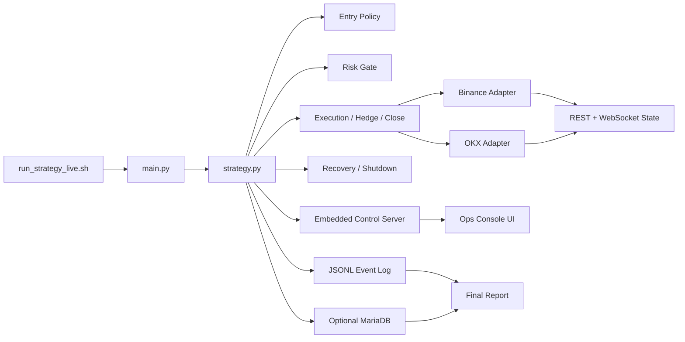

# Funding Arbitrage Execution Engine

Binance Futures와 OKX Futures를 대상으로 한 선물 페어 트레이딩 실행 엔진입니다. 핵심은 전략 아이디어 자체보다, 실제 거래 환경에서 필요한 주문 실행, 헷지, 청산, 복구, 운영 제어, 사후 검증을 일관된 하나의 시스템으로 묶는 것입니다.

이 프로젝트는 수익률을 홍보하기 위한 저장소가 아닙니다. 현재 초점은 **전략을 교체해도 안전하게 굴러가는 execution / OMS / ops layer**입니다.

## Current Status

- Main path: Binance Futures / OKX Futures
- Runtime: live and test separated by env file
- Control plane: strategy-attached embedded Ops Console
- Persistence: optional MariaDB, DB-less runtime supported
- Latest operational baseline: 24h live run `PASS warnings=0 failures=0`
- Strategy profitability: evaluated separately from system stability

## What It Handles

- Exchange REST/WebSocket adapters for orderbook, account, position, order, trade, and funding state
- Maker first-leg entry with immediate hedge on the opposite exchange
- Pair close, emergency flatten, account imbalance recovery, and shutdown cleanup
- Entry gates for active pair, open order, margin mode, exposure cap, rate-limit pressure, and manual ownership
- Embedded Ops Console for manual order, hedge, flatten, cancel, pause, and resume
- Structured JSONL events, optional MariaDB persistence, and final PASS/FAIL reports
- Symbol price collector and FX collector as separate runtime services

## Engineering Guarantees

The operational layer is designed around these invariants:

| Area | Guarantee |
| --- | --- |
| Hedge completeness | First-leg fills are hedged or rolled back; residuals go through recovery instead of being ignored blindly |
| Order safety | Duplicate order, overfill, stale orderbook, orphan position, and open-order mismatch paths are guarded |
| Shutdown safety | Stop path cancels open orders, closes tracked pairs, flattens leftovers, and records shutdown state |
| Control isolation | Console actions use the strategy-owned exchange sessions through a command queue |
| Auditability | Final report checks events, DB consistency, live exchange flat state, API pressure, and collector freshness |

## Architecture



## Main Components

| Area | Files |
| --- | --- |
| Runtime entry | [main.py](main.py), [strategy.py](strategy.py) |
| Strategy modules | [src/strategy](src/strategy) |
| Binance adapter | [src/binance_f_module](src/binance_f_module) |
| OKX adapter | [src/okx_f_module](src/okx_f_module) |
| Ops console | [src/ops_console](src/ops_console) |
| Persistence/reporting | [src/ops](src/ops), [scripts/ops](scripts/ops) |
| Runtime scripts | [scripts/runtime](scripts/runtime) |
| DB schema | [sql/trading_dev_schema.sql](sql/trading_dev_schema.sql) |

## Quick Start

실제 key, token, DB password는 커밋하지 않습니다. 실행 설정은 실서버는 `.env`, 테스트 서버는 `test_server/.env`를 사용합니다.

```bash
.venv/bin/python -m py_compile main.py strategy.py src/strategy/config.py
bash -n scripts/runtime/run_strategy_live.sh
```

테스트 서버 실행:

```bash
STRATEGY_ENV_FILE=test_server/.env STRATEGY_RUN_DURATION=30m scripts/runtime/run_strategy_live.sh start
```

실서버 실행:

```bash
STRATEGY_ENV_FILE=.env STRATEGY_RUN_DURATION=12h scripts/runtime/run_strategy_live.sh start
```

상태 확인과 종료:

```bash
STRATEGY_ENV_FILE=.env scripts/runtime/run_strategy_live.sh status
STRATEGY_ENV_FILE=.env scripts/runtime/run_strategy_live.sh health
STRATEGY_ENV_FILE=.env scripts/runtime/run_strategy_live.sh stop
```

최종 리포트:

```bash
STRATEGY_ENV_FILE=.env scripts/runtime/run_strategy_live.sh final-report --label real_12h
```

## Ops Console

Ops Console은 전략 프로세스에 내장된 control plane에 붙는 thin client입니다. 콘솔이 별도 exchange polling session을 만들지 않으므로, 브라우저를 열어도 전략과 별개의 API pressure가 생기지 않습니다.

```env
OPS_CONSOLE_HOST=127.0.0.1
OPS_CONSOLE_PORT=8010
```

```bash
STRATEGY_ENV_FILE=.env scripts/runtime/run_strategy_live.sh start
STRATEGY_ENV_FILE=.env scripts/runtime/run_ops_console.sh status
STRATEGY_ENV_FILE=.env scripts/runtime/run_ops_console.sh health
```

접속:

```text
http://127.0.0.1:8010
```

디버깅 목적의 legacy standalone console은 명시적으로만 사용합니다.

```bash
OPS_CONSOLE_FORCE_STANDALONE=1 STRATEGY_ENV_FILE=.env scripts/runtime/run_ops_console.sh start
```

## Reports

Final report는 운영 안정성을 판단하는 기준입니다. 전략 수익성 판단과 분리해서 봅니다.

PASS 기준:

- `pair_entry_overfill_detected=0`
- `pair_close_leg_failed=0`
- `pair_close_pending=0`
- `danger_log_lines=0`
- `remaining_positions=[]`
- live Binance/OKX positions `0`
- live Binance/OKX open orders `0`
- DB open-like orders `0`
- order/trade reconcile `PASS`
- API pressure and IP ban checks `PASS`

최근 검증 기준선:

```text
final_verdict=PASS warnings=0 failures=0 blocking=0
observed_duration=24h 0m 3s
```

## Documentation

- [docs/runbook.md](docs/runbook.md): 실행, 중지, health, final report, 장애 대응
- [docs/env_vars.md](docs/env_vars.md): 환경변수와 secret 분리 원칙
- [docs/operator_log_guide.md](docs/operator_log_guide.md): 운영 로그 해석 기준
- [docs/development_requirements_checklist.md](docs/development_requirements_checklist.md): 요구사항 반영 상태
- [docs/question4_comparison.md](docs/question4_comparison.md): reference 구현과의 비교
- [docs/strategy_quality_roadmap.md](docs/strategy_quality_roadmap.md): 전략 품질 개선 로드맵
- [docs/strategy_experiment_loop.md](docs/strategy_experiment_loop.md): 전략만 교체해 실험하는 표준 루프
- [docs/strategy_evaluation_criteria.md](docs/strategy_evaluation_criteria.md): expected/actual edge와 체결 품질 평가 기준
- [docs/strategy_live_operations_runbook.md](docs/strategy_live_operations_runbook.md): 새 전략을 실거래로 옮기는 운영 절차
- [test_server/README.md](test_server/README.md): 테스트 서버 실행 가이드

## Safety Notes

- This repository is not investment advice.
- Do not commit `.env`, API keys, tokens, DB passwords, runtime files, or logs.
- Live trading should be preceded by test-server runs, shutdown checks, and final report review.
- Strategy profitability is not assumed from operational PASS reports.
